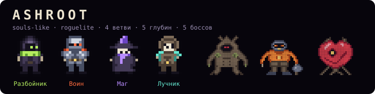

# Ashroot — souls-like пиксельный слешер (MVP)

**▶ Играть: https://x1as.github.io/ashroot/** (ПК и телефон, лучше в горизонтальной ориентации)

Вид сверху, как в мобильных играх. Спускаешься в корни Пепельного Древа: 5 глубин, в каждой 5 залов, костёр и босс.
Главное меню — само Древо: 43 узла (98 рангов), ствол общий, 4 ветви на 4 класса.

## Запуск

```powershell
npm install
npm run dev        # http://localhost:5173  (?debug: N убить всех, B к боссу, G +500 пепла, I бессмертие)
npm run build      # index.html + dist/ashroot.html (один файл ~176 KB, открывается с диска)
npm run balance    # симулятор баланса, exit 1 если нарушен контракт
npm run deploy     # собрать и выложить dist/ в ветку gh-pages (GitHub Pages)
```

## Сохранения и достижения

Игра одиночная, прогресс хранится в браузере (`localStorage`): пепел, Древо, отголосок, статистика.
- `src/game/save.js`: версия схемы и миграции (старые сохранения не ломаются при обновлениях), каждая запись дублируется в резервный ключ, есть `exportSave` / `importSave` для переноса между устройствами.
- `src/game/events.js`: игра только сообщает факты (`kill`, `bossKill`, `perfect`, `counter`, `runEnd`, `nodeBuy`…), статистика и достижения их слушают.
- `src/game/achievements.js`: достижение добавляется одной записью `{ id, name, desc, on, test }`, код боя трогать не нужно. Экрана достижений пока нет.

Управление: WASD, ЛКМ/J атака (лучник: держать = натяг), Space перекат, E/ПКМ умение, Q фляга, Esc пауза. На телефоне стик и 4 кнопки.

## Почему веб, а не Godot

Godot 4.7 установлен, и для релиза в сторы он лучше. Для MVP я выбрал Canvas + чистый JS без движка:
- ссылка сразу открывается на телефоне, ничего не надо экспортировать;
- игру можно проверять автоматически: бот проходит все 5 этажей в ускоренной симуляции;
- это твой стек (JS), архитектуру можно читать и менять без изучения GDScript.

Данные (`src/data/*`) — чистые объекты без DOM, их можно перенести в Godot как есть.

## Архитектура

```
src/data/      ЧТО: классы, враги, боссы, дары, древо, этажи. Только данные, импортируются и в Node (симулятор)
src/game/      КАК: stats (класс → древо → дары), combat (весь урон), player, enemy, boss (генераторы), world, run, scene
src/engine/    ДВИЖОК: sprite baker, input (клавиатура/тач, буфер нажатий), audio (WebAudio, без файлов), fx, util
src/art/       ПИКСЕЛИ: строки-сетки + палитра → canvas при старте
src/ui/        HUD (canvas), меню-древо (canvas + DOM), оверлеи (DOM)
tools/         balance.mjs (симулятор), bot.js (soak-бот), atlas.html (все спрайты), svg.mjs, build.mjs, serve.mjs
```

Рендер: мир рисуется в буфер с настоящей пиксельной сеткой, буфер масштабируется по ближайшему соседу с субпиксельным сдвигом камеры. Пиксели остаются чёткими, а прокрутка плавной. Текст и HUD рисуются поверх в полном разрешении.

## Дизайн

**Риск-дизайн, простой.** Мир почти монохромный. Насыщенный цвет есть только у трёх вещей: ткань твоего героя (цвет класса), красные телеграфы врагов и цвета аспектов. По цвету сразу видно, что твоё и что опасно.

**Бой (Tough-but-Fair).** У каждой атаки три фазы: замах-телеграф (≥ 0.40 с) → удар → окно наказания (≥ 0.55 с). Симулятор это проверяет.
- Прицел врага следит за тобой первые 65% замаха, потом фиксируется. Перекат после фиксации срабатывает всегда.
- Удар в белую вспышку конца замаха = **КОНТР**: прерывание, оглушение, ×1.5 урона. Это парирование, которому не нужна отдельная кнопка на телефоне.
- Перекат в первые 0.14 с под ударом = **ИДЕАЛЬНО**: замедление времени, возврат выносливости, следующий удар — крит.
- Урон по тебе без рандома. Одновременно замахиваться могут не больше 2 врагов (attack tokens).
- **Отмщение** (как rally в Bloodborne): потерянное HP можно вернуть, если сразу бить в ответ. Доля зависит от класса, поэтому выигрывает агрессия, а не стояние под ударами.

**Нетранзитивный баланс вместо умножения HP.** Плоская броня режет мелкие удары, щит блокирует спереди, у части врагов есть сопротивления, культист телепортируется.

| | сильнее против | слабее против |
|---|---|---|
| Разбойник | культисты, стрелки | щитоносцы, рыцари (броня) |
| Воин | щитоносцы (пробой стойки) | культисты (телепорт), падальщики |
| Маг | щитоносцы, рыцари (чары сквозь броню) | культисты (сопротивление чарам) |
| Лучник | культисты | скелеты (стрелы сквозь рёбра); щит пробивает только натянутая стрела |

**Этаж = Kishōtenketsu + кривая интереса** (напряжение 3 · 5 · 7 · 3 · 8 · 0 · 10, полосками в HUD):
1. Встреча — новый враг один, в открытом зале.
2. Местность — обрывы с мостиками или шипы с детерминированным ритмом. Падальщика можно сбросить в бездну.
3. Поворот — враги с разной дальностью атаки одновременно.
4. Развилка — передышка и выбор пути: обычная тропа или **проклятая** (элита, урон врагов ×1.25, зато 2 дара).
5. Арена — элитный мини-босс.
6. Костёр — безопасный зал: Отдых (+50% HP, +1 фляга) или Жертва (ещё один дар без лечения).
7. Босс — 5 боссов из общих приёмов-генераторов, вторая фаза на 50% HP.

**Дары (после каждого зала выбираешь 1 из 3).** 5 аспектов: Кровь, Пламя, Иней, Гроза, Тень. 3 уровня аспекта дают **Резонанс I**, 5 уровней — **Резонанс II**. Резонанс меняет правила, а не прибавляет проценты. Пример: при Тени II криты бьют ×3, при Грозе II идеальный перекат бьёт молнией по всем врагам. Есть **Пакты**: сильный плюс с настоящим минусом. Вместо дара можно отдохнуть (+35% HP). «Кураж»: быстрая зачистка даёт бонусный пепел.

**Souls-петля.** Пепел сохраняется в Древе после победы над боссом. При смерти половина несохранённого пепла уходит в Древо, вторая половина остаётся **Отголоском** в первом зале этого этажа. Умрёшь ещё раз, не дойдя до него, — он пропадёт.

## Проверка

- `npm run balance`: контракт телеграфов, время убийства (TTK), сколько ударов ты выдерживаешь, длина боя с боссом, матрица матчапов. Сейчас все проверки проходят.
- Бот с бессмертием: все 4 класса проходят 5 этажей (35 залов, 5 боссов), 0 ошибок.
- Бот без бессмертия и без нормальных перекатов гибнет на 1–5 этаже, чаще всего на боссах. Раньше воин-бот проходил игру, просто стоя под ударами; это исправлено.
- Полное Древо стоит 11 215 пепла. Полный забег приносит около 900–2400, ранняя смерть — около 50–200.

## Скиллы

- `layer-pixel-art` (установлен): из него взяты фиксированная сетка и палитра, запрет на сглаживание и правило «каждый кадр выводится из первого». Его генератор требует сервис Layer, которого нет, поэтому спрайты нарисованы по этим правилам вручную.
- `pixel-art-animator`: из него взяты тайминги. Idle — 2 кадра по 500 мс туда-обратно, бег — 4 кадра (contact/down/passing/up) около 100 мс, атака — замах → удар 30–80 мс → доводка → восстановление. Сам скилл требует Aseprite MCP, поэтому не установлен.
- `pixel-art` (SVG, установлен): им сделана обложка `docs/hero.svg` из тех же спрайтов.
